# SkyWatch

A weather app on a self-managed Kubernetes cluster: 3 local VMs, built with one command.
Type a city and SkyWatch shows its current temperature and conditions, from Open-Meteo.

Everything runs through `make`. The Makefile is only a short menu; the logic lives in scripts and
playbooks. `make vms` creates the VMs with a bash script, `make cluster` runs the Ansible playbook,
`make verify` checks the result against the requirements, and `make up` runs all three in order.
`make help` lists every target.

**`make up` gives you:**
- A 3-node **K3s** cluster (1 control plane + 2 workers) on Multipass VMs, installed by Ansible
- **ArgoCD**, which deploys everything else from this Git repo (GitOps)
- **The app**: a Flask frontend and a Flask backend (2 replicas) that asks [Open-Meteo](https://open-meteo.com/) for the weather
- **Monitoring**: Prometheus + Grafana, with a SkyWatch dashboard and alerts

A push to `main` is built by GitHub Actions and reaches the cluster through ArgoCD, with no manual steps.

## Bring it up in 3 steps

### 1. Install the tools (once)

You need Windows 10/11 **Pro** with WSL 2 (Ubuntu), [Multipass](https://canonical.com/multipass/install),
[kubectl](https://kubernetes.io/docs/tasks/tools/install-kubectl-linux/) and
[helm](https://helm.sh/docs/intro/install/) in WSL, and about 14 GB of free RAM. Then, inside WSL:

```bash
git clone https://github.com/reutyadid/skywatch.git ~/projects/skywatch
cd ~/projects/skywatch
ssh-keygen -t ed25519                     # skip if ~/.ssh/id_ed25519.pub already exists
python3 -m venv .venv-ansible
.venv-ansible/bin/pip install -r infra/ansible/requirements.txt
.venv-ansible/bin/ansible-galaxy collection install -r infra/ansible/requirements.yml
```

<details>
<summary>Requirements in detail: resources, versions, WSL settings</summary>

**Resources**

| | RAM | vCPU | Disk |
|---|---|---|---|
| `sw-server` (control plane) | 3 GB | 2 | 10 GB |
| `sw-worker1`, `sw-worker2` | 3.5 GB each | 2 each | 20 GB each |
| WSL | 4 GB | 4 | — |
| **Total** | **~14 GB** + Windows itself | shared with the host | **~50 GB** (VM disks grow as used) |

Built and tested on 24 GB (21.9 GB usable); 16 GB is tight. Close Docker Desktop while the
cluster runs: it lives inside WSL and competes for memory.

**Versions used** (newer patch versions should work)

| Tool | Where | Version | Used for |
|---|---|---|---|
| Windows 10/11 Pro or Enterprise | host | — | Hyper-V, which Multipass uses (Home has none) |
| WSL 2 + Ubuntu | host | Ubuntu 24.04 | runs everything else |
| Multipass | Windows | 1.16.4 | the 3 VMs; called from WSL as `multipass.exe` |
| make, git, Python 3 + venv | WSL | make 4.3, Python 3.12 | the Make menu, Ansible's venv |
| kubectl | WSL | 1.37 | using the cluster (K3s is 1.36) |
| helm | WSL | 4.3.1 | Ansible installs ArgoCD with it |
| ansible-core, kubernetes.core | `.venv-ansible` | 2.21.5, 6.6.0 | pinned in `infra/ansible/requirements.*` |
| Docker | WSL | any | only for `make lint` |

```bash
sudo apt update && sudo apt install -y make git python3-venv
multipass.exe version                     # expected: multipass 1.16.x+win
.venv-ansible/bin/ansible --version       # expected: ansible [core 2.21.5]
```

**WSL settings.** WSL must use NAT networking: mirrored mode has no route to the Hyper-V
Default Switch, where the VMs live ([D-003](docs/decisions.md#d-003--host-networking-and-project-location)).
In `C:\Users\<you>\.wslconfig`, then run `wsl --shutdown` in PowerShell:

```ini
[wsl2]
memory=4GB
processors=4
networkingMode=nat
```

**Clone inside WSL**, not under `/mnt/c`: there Ansible ignores `ansible.cfg`, because the
directory is world-writable.

**For `make test` and `make lint` only** (not needed for the cluster):

```bash
python3 -m venv .venv
.venv/bin/pip install -c requirements/constraints.txt \
  -r apps/backend/requirements-test.txt -r apps/frontend/requirements-test.txt
```

</details>

### 2. After every Windows reboot

Run this once in an **admin PowerShell**, so WSL can reach the VMs:

```powershell
Get-NetIPInterface | Where-Object { $_.InterfaceAlias -like 'vEthernet (WSL*' -or $_.InterfaceAlias -eq 'vEthernet (Default Switch)' } | Set-NetIPInterface -Forwarding Enabled
```

<details>
<summary>Why this is needed</summary>

WSL (in NAT mode) and the VMs (on the Hyper-V Default Switch) are on two different virtual
networks. Windows routes between them only when IP forwarding is on for both adapters, and it
resets that setting on every boot. To check, once the VMs exist: `ping -c 1 sw-server.mshome.net`
gets a reply.

</details>

**If the cluster is already installed**, check it with `make verify`. If it fails on
*Each node's InternalIP is its VM's current IP*, restart K3s (server first), then CoreDNS:

```bash
ssh ubuntu@sw-server.mshome.net 'sudo systemctl restart k3s'
ssh ubuntu@sw-worker1.mshome.net 'sudo systemctl restart k3s-agent'
ssh ubuntu@sw-worker2.mshome.net 'sudo systemctl restart k3s-agent'
export KUBECONFIG=$PWD/kubeconfig
kubectl -n kube-system rollout restart deploy/coredns
make verify
```

<details>
<summary>Why this is needed</summary>

Hyper-V doesn't reboot the VMs with Windows: it saves them on shutdown and restores them on boot
(`AutomaticStopAction = Save`). The network moves to a new address range, so each VM comes back
with a new IP, but K3s keeps running with the old one. Nodes and pods still look Ready, yet
traffic between VMs fails, and CoreDNS still forwards external names to the old network's DNS
server, so every city search fails. Restarting K3s makes each node pick up its new IP. Restarting
CoreDNS gives it the new DNS server. In the first minute the agents may restart a few times
(`failed to find interface with specified node ip`) before the node's IP is updated; that is
expected. Details in [`docs/troubleshooting.md`](docs/troubleshooting.md).

</details>

### 3. Bring everything up

```bash
make up
```

It takes several minutes (mostly downloads, so it depends on your internet speed) and ends with `failed=0`. Along the way, lines saying
`FAILED - RETRYING` are **normal**: that is the check waiting for ArgoCD to finish deploying.

<details>
<summary>What each step does, and what healthy output looks like</summary>

`make up` runs three steps in order and stops at the first failure. Each can be run on its own.

| Step | What it does |
|---|---|
| `make vms` | `infra/scripts/create-vms.sh`: launches the 3 Ubuntu 24.04 VMs and puts your SSH key in through cloud-init. Existing VMs are skipped. The first run also downloads the Ubuntu image. |
| `make cluster` | `infra/ansible/playbooks/site.yml`: waits for SSH, installs the pinned K3s, joins the workers, saves `./kubeconfig`, creates the Grafana admin Secret, installs ArgoCD and applies the root app. ArgoCD then deploys the app and monitoring from Git. |
| `make verify` | `infra/ansible/playbooks/verify.yml`: reads each VM's IP over SSH, then checks the requirements against the cluster, waiting where ArgoCD is still syncing. Read-only. On a running cluster it takes about half a minute. |

**`make vms`** ends with 3 running VMs. The IPs change on every boot; Ansible, kubectl and the
workers use the `<vm>.mshome.net` names, which follow them. K3s itself keeps the IP each node had
when it started, so after a Windows reboot it needs a restart (step 2):

```
Name                    State             IPv4             Image
sw-server               Running           192.168.x.x      Ubuntu 24.04 LTS
sw-worker1              Running           192.168.x.x      Ubuntu 24.04 LTS
sw-worker2              Running           192.168.x.x      Ubuntu 24.04 LTS
```

**`make cluster`** ends with `failed=0` and `unreachable=0` on every host. A second run on a
healthy cluster gives `changed=0` everywhere (the playbook is idempotent).

```
localhost                  : ok=5    changed=4    unreachable=0    failed=0  ...
sw-server.mshome.net       : ok=13   changed=7    unreachable=0    failed=0  ...
sw-worker1.mshome.net      : ok=9    changed=6    unreachable=0    failed=0  ...
sw-worker2.mshome.net      : ok=8    changed=6    unreachable=0    failed=0  ...
```

**`make verify`** prints lines like the one below for a few minutes while ArgoCD syncs
(monitoring takes longest). It only fails after 10 minutes:

```
FAILED - RETRYING: [localhost]: Wait until the ArgoCD apps are Synced and Healthy (R5.1-R5.3, B2) (59 retries left).
```

and then ends with:

```
localhost                  : ok=15   changed=0    unreachable=0    failed=0    skipped=0    rescued=0    ignored=0
sw-server.mshome.net       : ok=1    changed=0    unreachable=0    failed=0    skipped=0    rescued=0    ignored=0
sw-worker1.mshome.net      : ok=1    changed=0    unreachable=0    failed=0    skipped=0    rescued=0    ignored=0
sw-worker2.mshome.net      : ok=1    changed=0    unreachable=0    failed=0    skipped=0    rescued=0    ignored=0
```

It checks: 3 nodes Ready on the pinned K3s version; the server tainted, with no app pods on it;
the ArgoCD apps `root`, `skywatch` and `monitoring` Synced and Healthy; backend 2/2 and frontend
1/1; probes and resource limits on every container; each node's IP matching its VM's current
IP; the frontend answering through every node, which also tests traffic between VMs; the Grafana
admin Secret present. Run `make verify` again any time to re-check a running cluster.

`make verify` never calls Open-Meteo: it is often overloaded and would fail a healthy cluster.
To test a real search, open the app and search a city.

**Also normal:** a readiness probe warning (`connect: connection refused`) in the first seconds
of a new pod. The probe ran before gunicorn was listening; the pod is Ready a moment later.

</details>

## Open it

The app is open as soon as `make up` ends. ArgoCD and Grafana are not exposed outside the cluster:
open each one's port-forward first, in its **own terminal**, from the repo root, and keep it running
while you use it. Set `KUBECONFIG` in every new terminal before any `kubectl` command:

```bash
# Terminal 1: ArgoCD
export KUBECONFIG=$PWD/kubeconfig
kubectl -n argocd port-forward svc/argocd-server 8080:443

# Terminal 2: Grafana
export KUBECONFIG=$PWD/kubeconfig
kubectl -n monitoring port-forward svc/monitoring-grafana 3000:80
```

| | Address | Needs | Login |
|---|---|---|---|
| **App** | <http://sw-worker1.mshome.net:30080> | nothing (NodePort) | — |
| **ArgoCD** | <https://localhost:8080> (accept the self-signed certificate) | terminal 1 running | `admin` + the password command below |
| **Grafana** | <http://localhost:3000/d/skywatch/skywatch> | terminal 2 running | the commands below |

<details>
<summary>The commands that read each password</summary>

Run them in a third terminal, after `export KUBECONFIG=$PWD/kubeconfig`.

**ArgoCD**

```bash
kubectl -n argocd get secret argocd-initial-admin-secret -o jsonpath='{.data.password}' | base64 -d; echo
```

**Grafana**: the login is generated at bring-up and stored in the `grafana-admin` Secret.

```bash
kubectl -n monitoring get secret grafana-admin -o jsonpath='{.data.admin-user}' | base64 -d; echo
kubectl -n monitoring get secret grafana-admin -o jsonpath='{.data.admin-password}' | base64 -d; echo
```

The dashboard needs traffic: search a few cities in the app first.

**If something looks wrong**

- `kubectl` says `localhost:8080 ... connection refused` (or a certificate error): `KUBECONFIG`
  is not set in this terminal. `make cluster` writes `./kubeconfig`, not `~/.kube/config`.
- `localhost:8080` or `localhost:3000` doesn't open in the browser: its port-forward is not
  running. Start it again (terminal 1 or 2 above); it also stops when its pod restarts.
- The app shows "The weather service is unavailable": Open-Meteo is sometimes overloaded.
  The app handles it; retry a bit later.

</details>

## Tear down and other commands

```bash
make down      # delete the 3 VMs (only those); the next make up starts clean
make help      # list all targets
make verify    # re-check a running cluster
make test      # pytest for both services (needs .venv)
make lint      # ruff, helm lint, ansible-lint, hadolint (needs .venv and Docker)
```

## Architecture

**A request.** The frontend is the only part exposed to the host. It never calls Open-Meteo
itself; the backend does, with a 5s timeout. Prometheus scrapes both services.

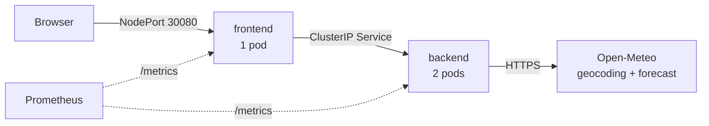

**A change.** Nobody runs `kubectl apply` or `helm install` for the app: Git is the source of
truth, and ArgoCD makes the cluster match it.

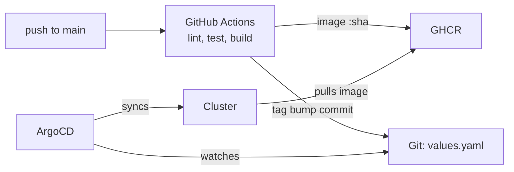

CI caches pip downloads and Docker layers in the GitHub Actions cache, one cache per service. Both
images are built on every push and tagged with its SHA, but a service whose code didn't change
builds almost entirely from cache. A push that changes only docs runs no CI at all.

**What runs where.** `make up` builds the cluster and installs ArgoCD; ArgoCD installs the rest.

| | `sw-server` (control plane) | `sw-worker1`, `sw-worker2` |
|---|---|---|
| Kubernetes | K3s server | K3s agent, Traefik |
| `skywatch` (the app) | — (tainted `NoSchedule`) | frontend ×1, backend ×2 (one per worker) |
| `argocd` | — | ArgoCD |
| `monitoring` | node-exporter only (a DaemonSet) | Prometheus, Grafana, Alertmanager, operator |

K3s's own add-ons (CoreDNS, metrics-server) tolerate the taint, so they can run on any node,
the server included; a restart can move them.

| Installed by | What |
|---|---|
| `infra/scripts` (bash + Multipass) | the 3 VMs |
| Ansible (`make cluster`) | K3s, `./kubeconfig`, the Grafana admin Secret, ArgoCD, the root app |
| ArgoCD, from Git | the app (`charts/skywatch`), monitoring (kube-prometheus-stack) |

## Repository layout

```
apps/                    the two services: app.py, Dockerfile, tests (one folder each)
charts/skywatch/         the Helm chart, one file per resource; values.yaml holds the image tags
argocd/                  root-app.yaml (app-of-apps) and apps/: skywatch.yaml, monitoring.yaml
infra/scripts/           create-vms.sh, destroy-vms.sh (Multipass)
infra/cloud-init/        puts the SSH key into each VM
infra/ansible/           playbooks/site.yml (bring-up), playbooks/verify.yml (checks), roles/
.github/workflows/       ci.yaml
requirements/            constraints.txt: every Python version, pinned once
docs/                    decisions.md (why), troubleshooting.md, requirements-checklist.md, work-plan.md, images/
Makefile                 the command menu: make up, down, verify, test, lint
```

## Key design decisions

Each one in a line; the D-number links to the full reasoning and the alternatives in
[`docs/decisions.md`](docs/decisions.md).

1. **Ansible bootstraps ArgoCD; ArgoCD installs everything else from Git (app-of-apps).** ArgoCD
   can't install itself the first time, so Ansible installs it from its official Helm chart and
   applies one root app. From then on, the root app creates the `skywatch` and `monitoring` apps from
   `argocd/apps/`, and Ansible never touches them, so two tools never manage the same resource.
   ([D-022](docs/decisions.md#d-022--argocd-installed-by-ansible-with-helm-then-app-of-apps))
2. **One Helm chart for both services, no subcharts.** They are built by one pipeline, tagged with
   one commit SHA and always released together, so one chart with one file per resource is the
   simplest fit. ([D-020](docs/decisions.md#d-020--one-helm-chart-no-subcharts))
3. **The CI bump commit cannot retrigger CI, in three independent ways:** it is pushed with
   `GITHUB_TOKEN` (which starts no workflows), `values.yaml` is in `paths-ignore`, and the message
   has `[skip ci]`. Any one of them could be changed by mistake later.
   ([D-019](docs/decisions.md#d-019--preventing-a-ci-trigger-loop))
4. **gunicorn runs 1 worker with threads per pod; scaling is by replicas.** The app mostly waits on
   HTTP, so threads are enough. With several worker processes, each would keep its own Prometheus
   counters and a scrape would hit a random one, so the numbers would jump backwards.
   ([D-012](docs/decisions.md#d-012--gunicorn-with-1-worker--n-threads))
5. **One shared constraints file pins every Python version.** `requirements/constraints.txt` is the
   single source of truth; each service lists only package names. The two services can't drift to
   different versions of the same library.
   ([D-015](docs/decisions.md#d-015--shared-constraints-file-for-dependency-versions))
6. **Logs are JSON to stdout only: no log files, no volumes.** The kubelet stores and rotates them
   on the node, and `kubectl logs` reads them. A volume for log files would also break with 2 backend
   replicas on different nodes, since a ReadWriteOnce volume can't be shared between them.
   ([D-024](docs/decisions.md#d-024--logs))

## Secret handling

**Approach: no secret is ever written to Git or typed by a person. Each one is generated where
it is needed, at bring-up.**

| Secret | Where it comes from | Where it lives |
|---|---|---|
| K3s join token | K3s generates it on the server | Ansible reads it from the server at run time and passes it to the workers (`no_log`); never stored |
| Grafana admin password | Ansible generates a random one, **only if the Secret doesn't exist yet** (so re-runs don't change it) | Secret `monitoring/grafana-admin`; the Grafana chart points to it with `existingSecret` |
| ArgoCD admin password | ArgoCD generates it on install | Secret `argocd/argocd-initial-admin-secret` |
| Cluster credentials | K3s | `./kubeconfig` on the host, mode `0600`, ignored by Git |
| CI push to GHCR and to `main` | GitHub's built-in `GITHUB_TOKEN`, scoped per job | never stored; no personal token. Images are public, so the cluster needs no pull secret |

**Why not Sealed Secrets, SOPS or ansible-vault:** each needs a key that belongs to one cluster or
one person. A reviewer bringing up a fresh cluster from this repo wouldn't have it, and the
bring-up would break. Here, anyone who clones the repo gets a working cluster with its own fresh
secrets. ([D-008](docs/decisions.md#d-008--k3s-join-token-not-stored-anywhere),
[D-023](docs/decisions.md#d-023--secrets))

**In production:** External Secrets Operator reading from Vault or a cloud secret manager, so Git
holds only a reference to each secret, never its value.

## Proof of the GitOps flow

### A code change, from commit to browser

One commit, `13307e1`, adds a subtitle to the home page. Follow the SHA through each step; no
command was run by hand.

**1. Before:** the home page has no subtitle. (The red error is Open-Meteo being overloaded at
that moment; see [Problems and solutions](#problems-and-solutions).)

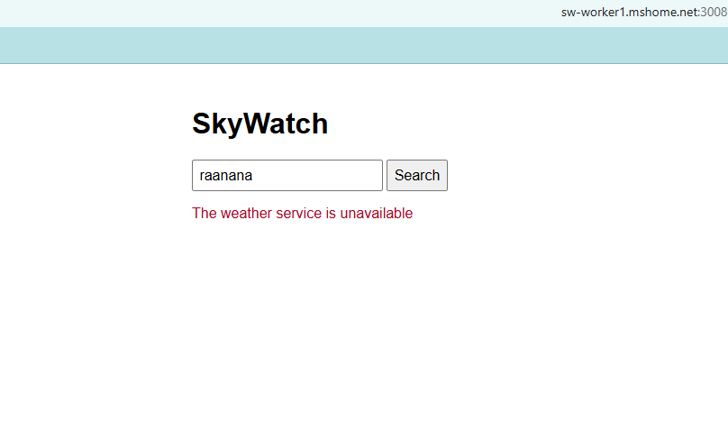

**2. The commit `13307e1`:** one line added to `apps/frontend/templates/index.html`.

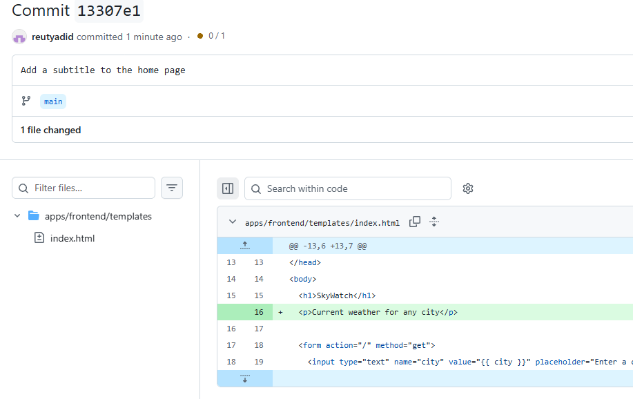

**3. CI run #9 for `13307e1`:** lint and test, then both images built and pushed to GHCR, then the
bump. 1m 46s.

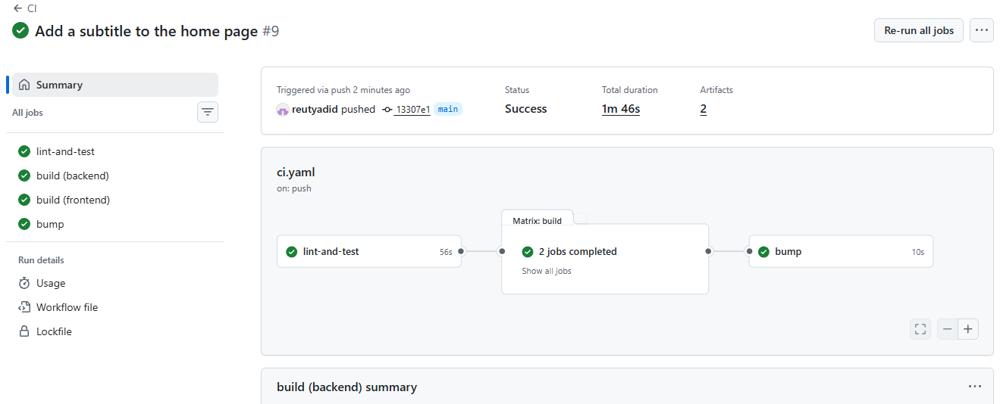

**4. The bot's commit `de8bc02`:** "Set image tags to 13307e1 [skip ci]", which changes only
`charts/skywatch`. It started no new CI run.

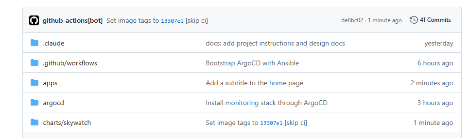

**5. ArgoCD synced to `de8bc02`** on its own (auto sync), the commit that sets the tag to `13307e1`.

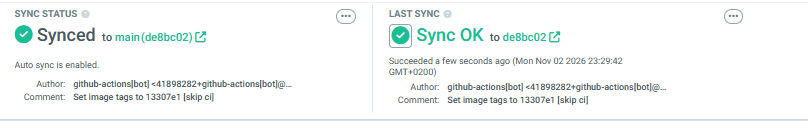

**6. After:** the new pod serves the subtitle "Current weather for any city".

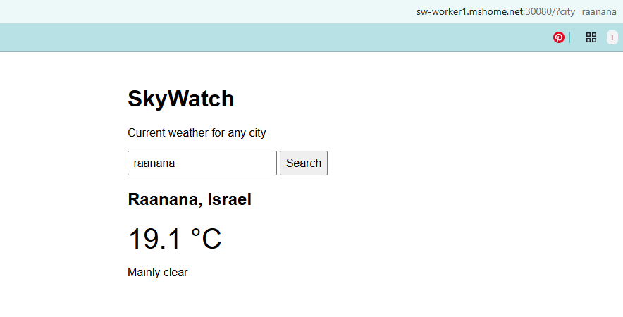

<details>
<summary>A config change: LOG_LEVEL INFO → DEBUG, with no rebuild</summary>

One commit, `b1976c6`, changes only `charts/skywatch/values.yaml`. Follow the SHA: no image is
built, ArgoCD syncs, and the pods restart with the new config.

**1. The commit `b1976c6`:** `LOG_LEVEL: INFO` → `DEBUG` for the backend.

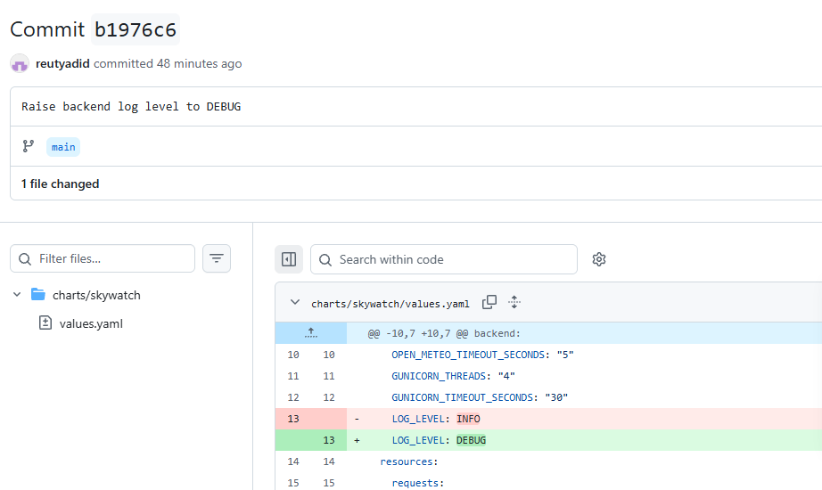

**2. No CI run for it:** the latest runs are for earlier commits. `values.yaml` changes don't
build images.

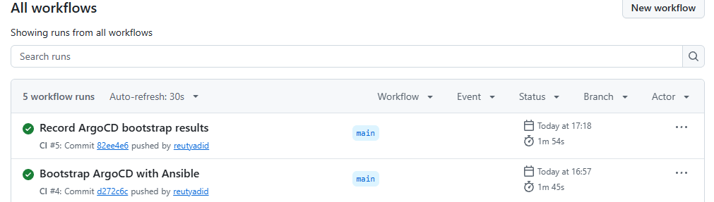

**3. ArgoCD synced to `b1976c6`:** Healthy, Synced, by the automated sync policy.

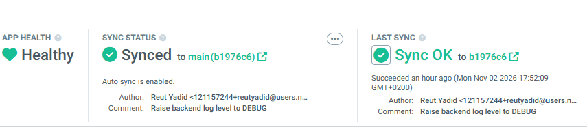

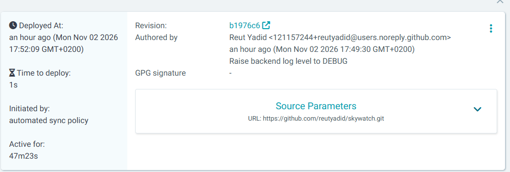

**4. In the cluster:** the ConfigMap says `DEBUG`, the backend pods are new (15:52, right after the
sync) but run the **same** image `82ee4e6`, and the logs now include DEBUG lines.

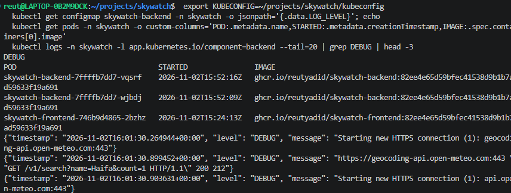

</details>

### Observability

The SkyWatch dashboard during a burst of searches: request rate, 5xx ratio (Open-Meteo errors
at the time), p95 latency, and 2 backend + 1 frontend pods up.

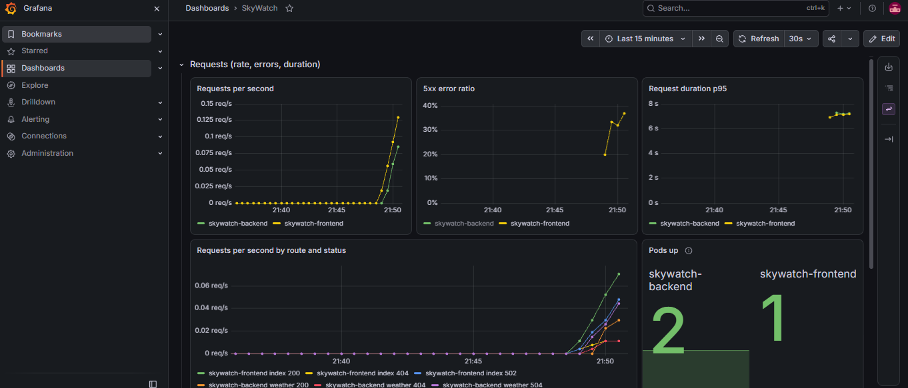

## Problems and solutions

The most instructive ones. Every problem met is in [`docs/troubleshooting.md`](docs/troubleshooting.md).

**WSL could not reach the VMs**
- Symptom: from WSL, `sw-server.mshome.net` resolved, but ping and SSH failed with `No route to host`.
- Cause: WSL's `mirrored` networking mode only mirrors physical adapters, so it had no route to the
  Hyper-V Default Switch, where the VMs live.
- Fix: `networkingMode=nat`, plus enabling IP forwarding between the two adapters in Windows
  (step 2 of the bring-up).

**ArgoCD failed to sync the app: no matches for kind "ServiceMonitor"**
- Symptom: the `skywatch` app failed to sync, Deployments included, with `no matches for kind
  "ServiceMonitor" in version "monitoring.coreos.com/v1"`.
- Cause: the `skywatch` and `monitoring` apps sync in parallel, and the ServiceMonitor CRD comes with
  monitoring. ArgoCD dry-runs every resource before applying any, so one unknown kind failed the
  whole sync.
- Fix: `SkipDryRunOnMissingResource=true` on the ServiceMonitor and PrometheusRule, plus a short
  sync `retry` that applies them once the CRDs exist. The monitoring bonus can never block the app.

**The K3s API timed out after monitoring was installed**
- Symptom: `kubectl` timed out and ArgoCD stopped syncing. On `sw-server`, `free -m` showed 56 MB
  free and the load average was 11.
- Cause: the 2 GB control plane was too small. The K3s server grew to ~1.5 GB holding the new CRDs,
  objects and watches, and the VM has no swap, so it thrashed.
- Fix: raised `sw-server` to 3 GB, in `create-vms.sh` too. About 1.4 GB is now free.
  ([D-010](docs/decisions.md#d-010--resource-sizing))

**Real cities showed "The weather service is unavailable"**
- Symptom: many searches failed, while an unknown city still got "City not found".
- Cause: Open-Meteo itself: called directly from the host, it answered `503 The service is
  overloaded` or not at all.
- Fix: none needed in the code. The backend turns upstream errors into a clear 502, the pods stay
  healthy (no probe calls Open-Meteo), and the dashboard shows the upstream error rate.

## What I'd improve with more time

- **Split the monorepo in a real project.** One repo fits a one-person assignment, but with several
  teams I would separate it: one repo per microservice (its code, CI and its own Helm chart), an
  umbrella Helm chart that composes the services' charts, and separate repos for the infrastructure
  (VMs, Ansible, ArgoCD) and for observability. Each team then owns and releases its part on its own.
- **Real VM reboots instead of save and restore.** After a Windows reboot the cluster needs a
  manual K3s and CoreDNS restart (step 2), because Hyper-V restores the VMs with new IPs
  (`AutomaticStopAction = Save`). Restarting a single VM already recovers on its own, since K3s
  starts fresh. Setting `AutomaticStopAction = ShutDown` would give the same on every Windows
  reboot. Not done because it needs an admin PowerShell (`create-vms.sh` runs in WSL without one),
  so it would be one more manual step in the bring-up; it resets to `Save` whenever the VMs are
  recreated; Windows shuts down and boots slower, since every pod restarts; and it needs another
  full reboot test to prove it also fixes CoreDNS. Another way: let `make cluster` repair it. Each
  K3s role would save the VM's IP in a small file on the VM, so a new IP changes the file and fires
  the existing restart handler, then restart CoreDNS. Not done: it changes the bring-up roles, and
  it needs another reboot plus a full `make down && make up` to test. (Putting the IP in K3s's own
  config would be simpler, but a single restarted VM would then no longer recover on its own.)
- **Ingress or Gateway API** through K3s's built-in Traefik, instead of a NodePort.
- **External Secrets Operator + Vault**, so secrets come from a secret manager.
- **Log storage** with Loki + Alloy; today logs live only as long as the pod.
- **High availability:** 2 frontend replicas, an HPA for the backend, Prometheus with persistent
  storage, and an Alertmanager receiver (Slack or on-call) so alerts reach someone.
- **Branch protection** on `main` with required reviews, and a dedicated identity for the CI bot.
- **ArgoCD sync waves** instead of the skip-dry-run and retry workaround for the ServiceMonitor CRD:
  install the CRDs first as their own step, then order the apps (CRDs, monitoring, app) with
  `argocd.argoproj.io/sync-wave`, so each one starts only after the one before it is healthy.
  For Applications this also needs a custom health check in `argocd-cm`
  ([D-022](docs/decisions.md#d-022--argocd-installed-by-ansible-with-helm-then-app-of-apps)).
- **ArgoCD managing its own installation**, so even its upgrades go through Git.

## AI use

Built with Claude Code as an assistant. [`CLAUDE.md`](CLAUDE.md) sets the principles and rules,
and `.claude/settings.json` blocks `git commit` and `git push` for the AI, so I reviewed and made
every commit myself. I can explain every part. ([D-030](docs/decisions.md#d-030--ai-assisted-work))
